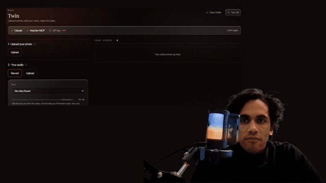

# Twin

▶ **[Watch with sound + download](https://ash601.github.io/twin/)**

You on camera without filming. Upload a photo, add your voice, get a talking video made by HeyGen.

## Use it
1. **Download** this folder: green **Code** button → **Download ZIP**, then unzip it.
2. **Double-click** `START.cmd` (Windows) or `START.command` (Mac). It opens in your browser.
3. **Connect HeyGen** at the top: your HeyGen account (through Claude Code), or paste a HeyGen API key.
4. **Upload your photo → add your audio → Make video.** It lands in *Your videos*.

You need: [Node.js](https://nodejs.org) and [ffmpeg](https://ffmpeg.org). For the account way: [Claude Code](https://code.claude.com/docs/en/setup) with the HeyGen connector on.

Everything stays on your computer, in the `my-twin` folder.
